# URL Shortener on AWS: Terraform, Docker and GitHub Actions

A URL shortener (Node.js, Express, PostgreSQL) deployed on AWS and managed entirely as code. The app is the small part. The project is about the infrastructure and delivery pipeline around it: a custom VPC, a load-balanced Auto Scaling group, a private database, and a CI/CD pipeline that logs in to AWS with **OIDC and no stored access keys**.

## Highlights

- **Infrastructure as code:** the whole AWS stack is Terraform, split into reusable modules, with remote state in S3.
- **Network design:** custom VPC across two availability zones, public subnets for the load balancer and app servers, private subnets for the database, and **no NAT gateway** (a deliberate cost decision, explained below).
- **Compute:** an Application Load Balancer in front of an Auto Scaling group of EC2 instances running the app as a Docker container. Unhealthy instances are replaced automatically.
- **Data and secrets:** RDS PostgreSQL in private subnets. The database password is generated by Terraform and stored in Secrets Manager, never in code.
- **CI/CD:** GitHub Actions runs checks and a `terraform plan` on every pull request, and deploys on every merge to `main`.
- **No stored credentials:** workflows authenticate to AWS through GitHub's OIDC identity tokens and receive temporary credentials.
- **Safer deploys:** rolling instance refresh (the site stays up while instances are replaced one at a time), plus rollback logic in the deploy workflow that restores the previous image if a rollout fails or times out.

## Architecture

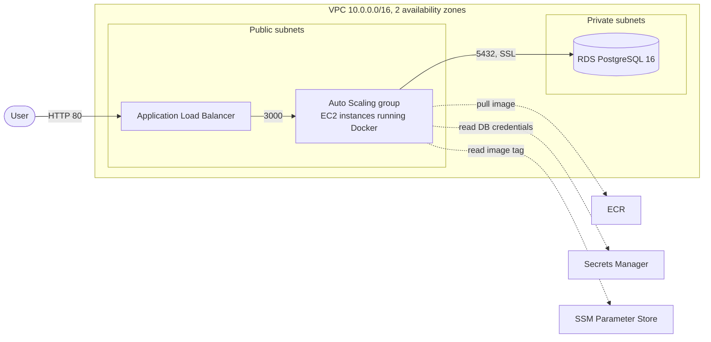

**Request flow:** the browser talks to the load balancer, which forwards to a healthy instance. The container reads and writes short links in PostgreSQL. The load balancer checks `GET /health` on every instance and stops sending traffic to any that fail.

**Boot flow:** each new instance installs Docker, reads the database credentials from Secrets Manager, creates the `urls` table if it does not exist, reads the image tag from SSM, pulls that image from ECR, and starts it.

## Tech stack

| Area | Tools |
| --- | --- |
| App | Node.js, Express, PostgreSQL, nanoid |
| Containers | Docker (multi-stage build), Docker Compose for local development |
| Cloud | AWS: VPC, ALB, EC2 Auto Scaling, RDS, ECR, Secrets Manager, SSM Parameter Store, IAM, S3 |
| IaC | Terraform (modules, remote state in S3 with lockfile locking) |
| CI/CD | GitHub Actions, OIDC federation to AWS |

## Repository structure

```
.
├── app/                      Node.js app, Dockerfile, compose file
├── infra/
│   ├── bootstrap/            one-time S3 bucket for Terraform state
│   ├── modules/
│   │   ├── vpc/              VPC, subnets, internet gateway, route tables
│   │   ├── ecr/              container registry, scan on push, lifecycle policy
│   │   ├── rds/              PostgreSQL, security group, generated password, secret
│   │   ├── alb/              load balancer, target group, listener
│   │   ├── asg/              IAM role, launch template, Auto Scaling group, scaling policy
│   │   └── github-oidc/      OIDC provider and the plan and deploy roles
│   └── envs/dev/             wires the modules together (backend, variables, outputs)
└── .github/workflows/
    ├── pr.yml                checks and terraform plan on pull requests
    └── deploy.yml            build, push and roll out on merge to main
```

## CI/CD pipeline

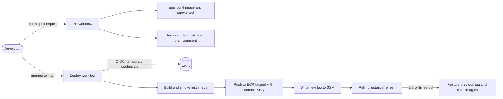

**Pull requests** run two required checks:

- `app` builds the Docker image, starts the container, and verifies that `/health` responds.
- `terraform` checks formatting, validates the code, runs `terraform plan`, and posts the plan as a comment on the pull request.

**Merging to `main`** starts the deploy workflow:

1. Assume the deploy role through OIDC.
2. Build the image and smoke-test it before anything is pushed.
3. Push the image to ECR tagged with the commit SHA.
4. Write the new tag to an SSM parameter and start a rolling instance refresh (at least 50 percent of instances stay healthy).
5. If the refresh fails or takes longer than 20 minutes, the workflow is written to restore the previous tag and refresh again, so the site returns to the last good version. This rollback path is implemented, and a live failure test is listed under future improvements.

**Why OIDC:** each workflow run gets a short-lived signed token from GitHub, and AWS exchanges it for temporary credentials only if the token matches a trust rule. There is no access key to leak. Two roles with different powers are used:

| Role | Who can assume it | Permissions |
| --- | --- | --- |
| Plan | pull request runs only | read-only |
| Deploy | runs on `main` only | push to one ECR repository, one SSM parameter, instance refresh on one Auto Scaling group |

The trust rules match the repository's exact owner and repository IDs, so a renamed or re-created repository cannot assume the roles.

## Security decisions

- No long-lived AWS credentials anywhere (OIDC, least-privilege roles, separate plan and deploy roles).
- The database is private, has no public access, accepts connections only from the app's security group, and requires SSL. Storage is encrypted.
- The database password is generated by Terraform and kept in Secrets Manager. It is never in the repository or in `tfvars`.
- App instances accept traffic only from the load balancer, have no SSH access (shell access is through SSM Session Manager), and require IMDSv2.
- Terraform state is stored in a private, versioned, encrypted S3 bucket with public access blocked and state locking.
- ECR scans images on push and keeps only the last 10 images.

## Design decisions and trade-offs

- **No NAT gateway.** A NAT gateway costs roughly $32 per month before any traffic. The app instances sit in public subnets instead, protected by security groups that only allow the load balancer in. The upgrade path is private subnets with a NAT gateway or VPC endpoints.
- **EC2 and Auto Scaling instead of containers-as-a-service.** This keeps the classic ALB, launch template and Auto Scaling pattern visible, and it is easy to reason about and debug.
- **Image tag stored in SSM.** A deploy writes a tag and starts a refresh, with no Terraform run, so the deploy role stays small. The trade-off is that the workflow implements its own rollback, because AWS's built-in refresh rollback only reverts launch template changes.
- **A smoke test instead of unit tests.** The project has no unit test suite. Every image is started and its health endpoint is checked before it can be pushed.
- **Dev-friendly settings.** RDS is single-AZ with no final snapshot so that `terraform destroy` is clean. A production setup would turn on Multi-AZ, backups and deletion protection.
- **HTTP only for now.** There is no custom domain or certificate yet.

## Run locally

Requirements: Docker.

```bash
cd app
docker compose up --build
```

Create a `.env` file first (the variable names are in `compose.yaml`). Then open http://localhost:3000.

API:

```bash
# create a short link
curl -X POST http://localhost:3000/api/shorten \
  -H "Content-Type: application/json" \
  -d '{"url": "https://example.com/some/long/path"}'

# open a short link (redirects with 302)
curl -i http://localhost:3000/<code>

# health check used by the load balancer
curl http://localhost:3000/health
```

## Deploy to AWS

Requirements: an AWS account, AWS CLI configured, Terraform 1.10 or newer, Docker.

1. **Create the state bucket (once):**
   ```bash
   cd infra/bootstrap
   terraform init && terraform apply
   ```
2. **Configure the dev environment.** Put your bucket name in `infra/envs/dev/backend.tf`, and set the values in `infra/envs/dev/terraform.tfvars`, including `github_repo`. The trust rule is exact and case sensitive. If GitHub's OIDC tokens for your repository carry numeric IDs, use the form `Owner@<owner-id>/repo@<repo-id>`. Printing the token claims in a workflow shows the real value.
3. **Create the infrastructure:**
   ```bash
   cd infra/envs/dev
   terraform init
   terraform apply
   ```
4. **Publish the first image.** Either run the Deploy workflow from the Actions tab, or push one by hand:
   ```bash
   aws ecr get-login-password --region us-east-1 | docker login --username AWS --password-stdin <account-id>.dkr.ecr.us-east-1.amazonaws.com
   docker build --platform linux/amd64 -t url-shortener ./app
   docker tag url-shortener:latest $(terraform output -raw ecr_repository_url):latest
   docker push $(terraform output -raw ecr_repository_url):latest
   ```
5. **Open the app:** `terraform output -raw alb_dns_name`. Instances need a few minutes to boot and pass health checks.
6. **Connect GitHub.** Add the repository variables `AWS_PLAN_ROLE_ARN` and `AWS_DEPLOY_ROLE_ARN` (from `terraform output -raw plan_role_arn` and `deploy_role_arn`, without quotes). Protect `main` and require the `app` and `terraform` checks.
7. **Tear down:** `terraform destroy` in `infra/envs/dev`. The state bucket in `bootstrap` is separate and stays.

## Cost

Rough monthly cost if left running 24/7 in us-east-1 (check current AWS pricing, and note that free tier credits may reduce it):

| Item | Approx. per month |
| --- | --- |
| Application Load Balancer | $16 to $20 |
| 2 x EC2 t3.micro | about $15 |
| RDS db.t3.micro, 20 GB | about $15 |
| Secrets Manager, ECR, S3, SSM | about $1 to $2 |
| NAT gateway | $0 (avoided, would be about $32 plus data) |

The stack is destroyed when it is not being tested.

## Screenshots

**The app running on AWS** (behind the load balancer):

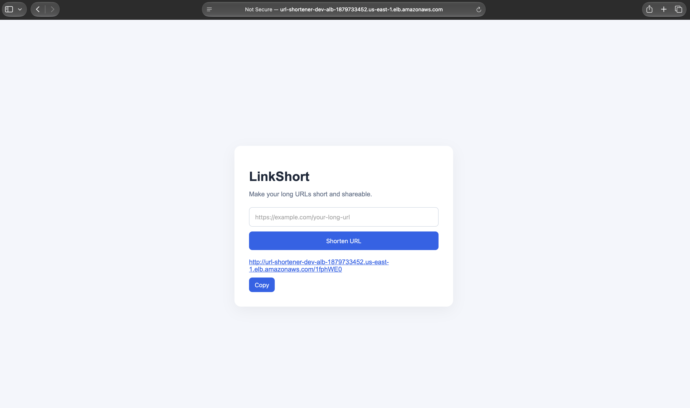

**Network.** The VPC resource map shows two availability zones, public and private subnets, and one internet gateway. Zero private subnets route to the internet, because there is no NAT gateway.

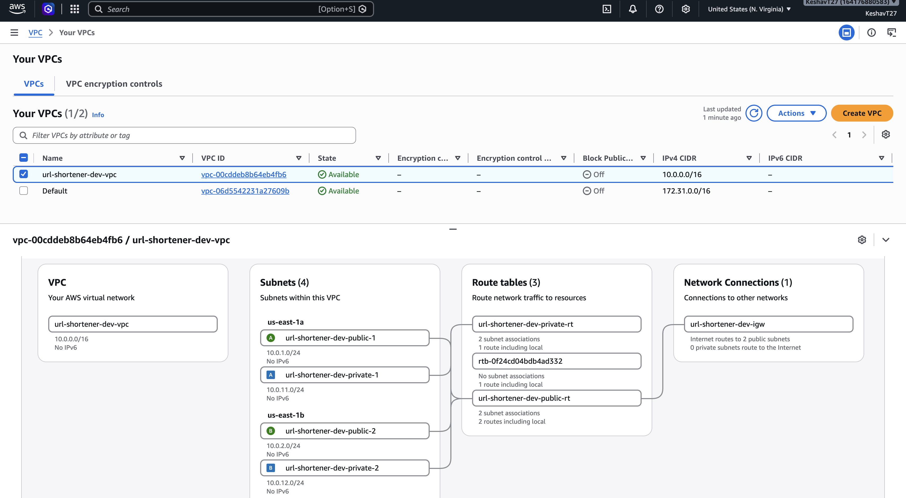

**Load balancer and Auto Scaling.**

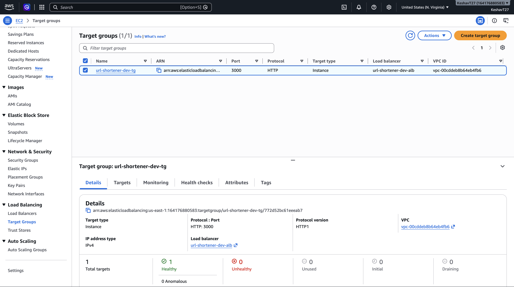
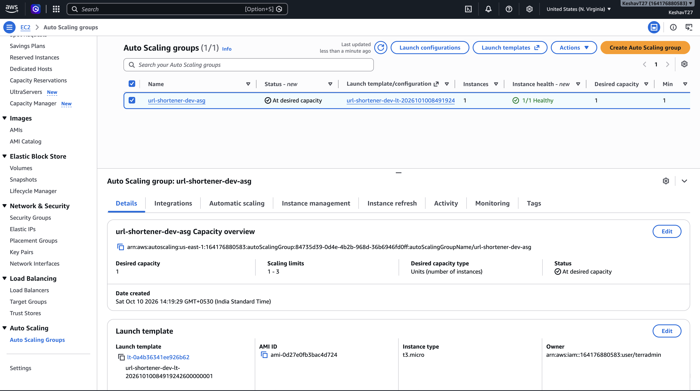
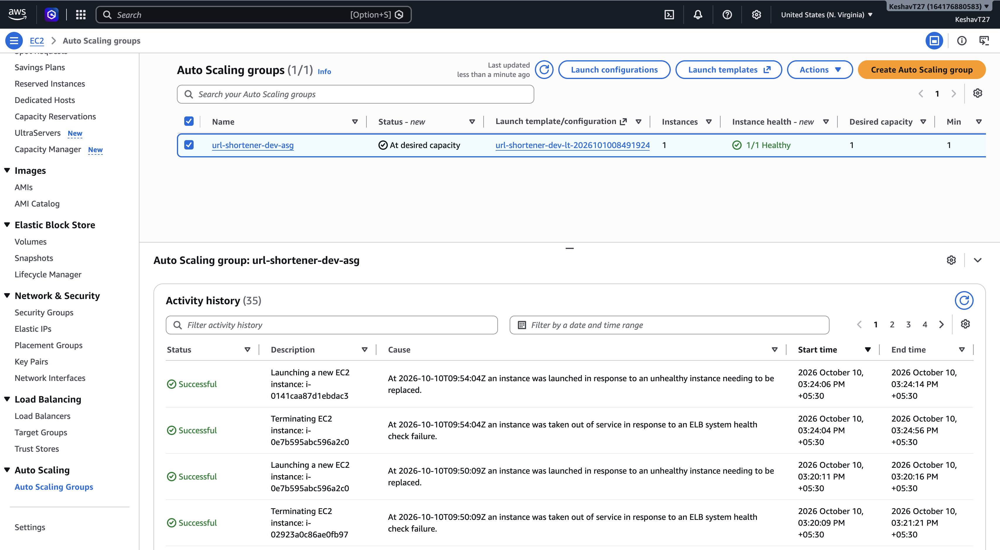
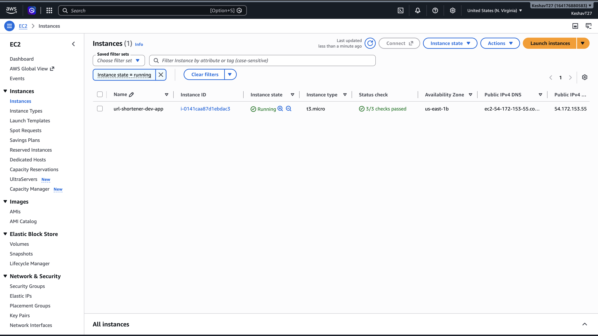

**Data, secrets and images.**

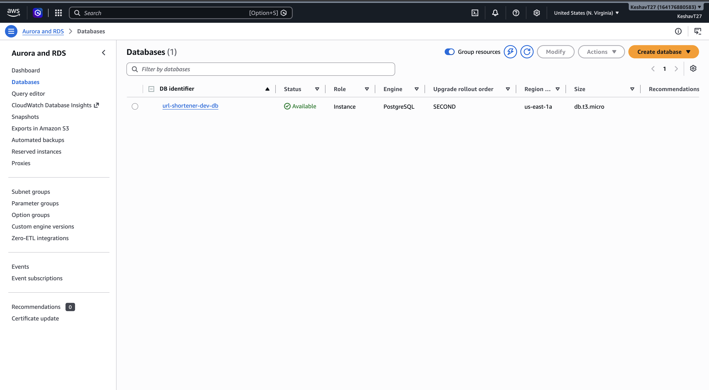
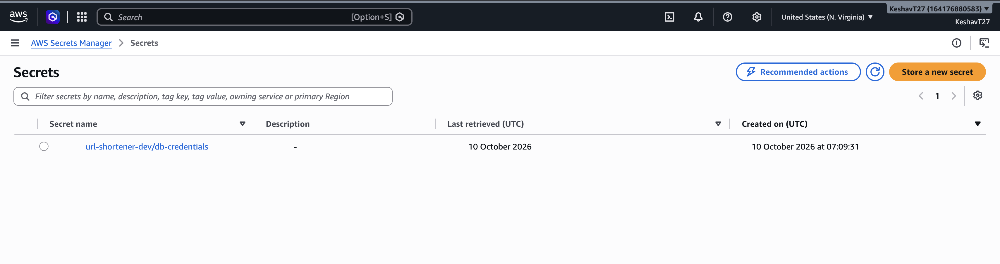
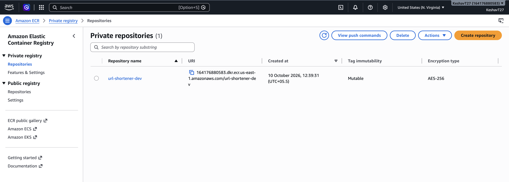

**Terraform state and outputs.**

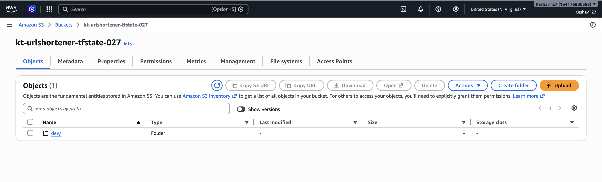
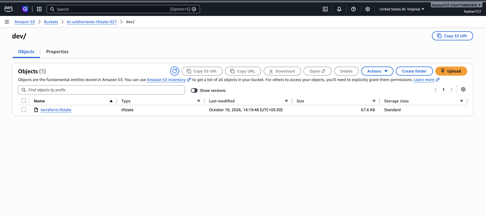
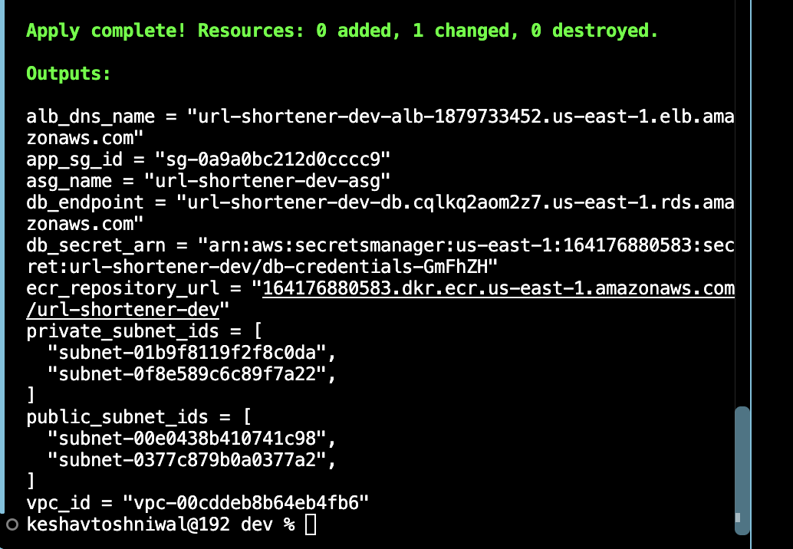

**CI/CD.** The run history of the pipeline, including the failed OIDC attempts that were debugged before the checks and the deploy turned green:

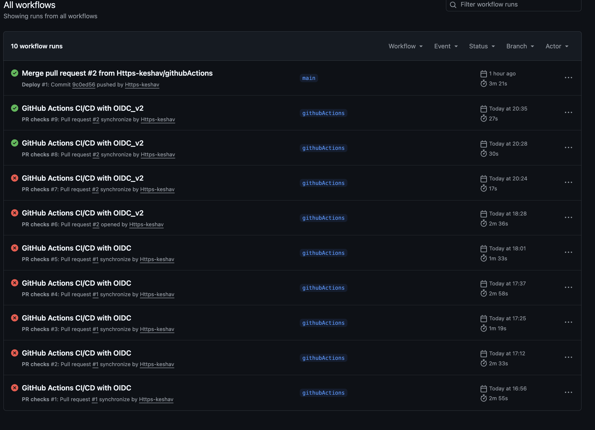

## What I learned

- Reading the real error is faster than guessing. The most stubborn problem was an OIDC login that failed with a generic "not authorized" message. It was solved by printing the token's actual claims and comparing them with the trust policy, which showed that GitHub puts numeric IDs in the subject.
- Terraform decides the provider from the first word of a resource type, so a missing `aws_` prefix gives a confusing error about a provider that does not exist.
- A missing `vpc_id` on a security group silently puts it in the default VPC, and the error shows up in other resources.
- Run the container locally and in CI before pushing. A smoke test catches startup crashes in seconds.
- Fresh builds expose ordering problems that a running stack hides, such as needing the image in ECR before instances boot.

## Future improvements

- HTTPS with ACM and Route 53
- CloudWatch alarms and a dashboard
- Private subnets for the app tier with VPC endpoints or a NAT gateway
- Immutable ECR tags
- Blue/green deployments
- A recorded live rollback test (deploying a deliberately unhealthy release)
- Unit and integration tests

## Author

Built by [Https-keshav](https://github.com/Https-keshav).
